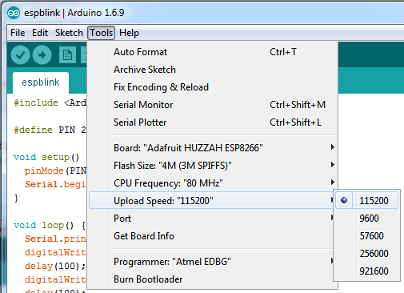
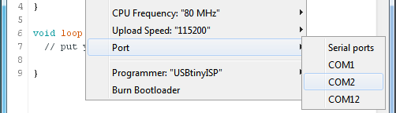
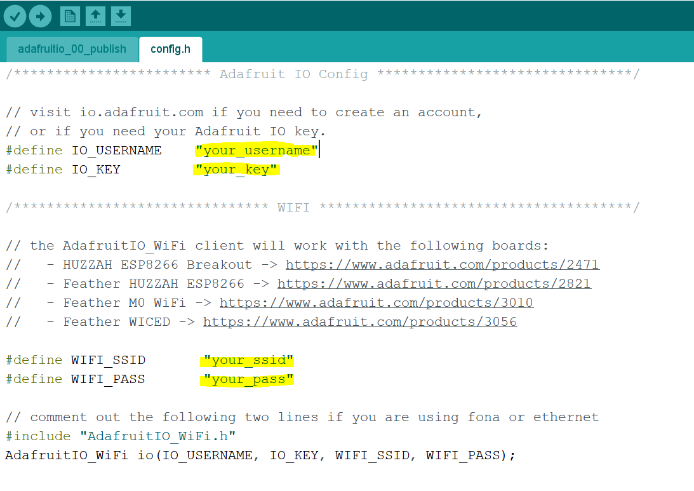

# Setting Up The Feather Huzzah

Before we start working on the IOT projects, let’s install all the necessary software and drivers on your laptop. 

**Configuring Arduino IDE**

1.  <mark style="background-color:coral;"><b>
Essentially, the first activity is to get the IoT board communicating with your computer. Newer version of Windows(10/11), Linux and MacOS have built-in driver for CP210x serial to USB driver. Thy handle the CP210x chip automatically without requiring you to manually download an installer from Silicon Labs. Confirm by checking Arduino IDE under Tools -> Port, you are already good to go and can upload sketches directly without touching any driver installers.

Plug-and-play: When you plug in the Adafruit Feather HUZZAH with a data-capable USB cable, in your Arduino IDE under Tools -> Port, if you see:
-  For Windows, Port name: Appears as COM3 (or COM4, COM5, etc.)
-  For Linux: /dev/ttyUSB0
-  For MacOS: /dev/cu.usbserial-XXXX

If you do not see the ports in the IDE, you need to manually install the serial to USB driver. Omitting, or not completing every step in the order outlined below, is often the source of errors in this workshop.</b></mark> A computer needs the appropriate driver to be able to talk to the Feather Huzzah through the USB cable. For older version of OS which does not have this serial to USB driver by default, you must manually install the necessary driver:
    -   Go to the Silicon Labs website and [download the appropriate driver for your computer's operating system](https://www.silabs.com/developers/usb-to-uart-bridge-vcp-drivers?tab=downloads){:target="_blank"}.
    -   Clicking on the name of the driver should download a .zip file. Find the .zip file in your "**Downloads**" folder. Right-click the .zip file and select "**Extract All...**"
    -   Now that you've downloaded the driver package, you have to install the driver. Go into the unzipped folder and find the installer .inf (or "**Setup Information**") file
    -   Right-click on this file, select "**Install**", and follow any installer instructions
    -   If you are using Macbook,stuck progress bar during the Silicon Labs CP210x VCP driver install on a MacBook usually happens because macOS is waiting for you to approve a blocked system/kernel extension or is hanging on the GUI installer.
          
1. Approve Blocked System Software in macOS
   1. Open System Settings (or System Preferences on older macOS versions).
   2. Go to Privacy & Security (or Security & Privacy).
   3. Look for a notice stating system software from Silicon Laboratories Inc or CP210xVCPDriver was blocked.
   4. Click Allow, enter your Mac password, and finish the prompt.
2. Run the Installer from Terminal
 If CP210xVCPDriver.app is already in /Applications, running it via Terminal often bypasses a stuck GUI progress bar:
 1. Quit the stuck installer.
 2. Open Terminal and run bash below:
/Applications/CP210xVCPDriver.app/Contents/MacOS/CP210xVCPDriver install
    
 3. Uninstall, Reboot, and Check if the Driver Already Loaded
      
• Sometimes the installer hangs or reports a failure even after copying the driver files. Check in Terminal if the          port or extension already exists:

            ls /dev/cu.*
            kextstat | grep silabs
    
 • If it is stuck or broken, run the uninstaller first, restart your MacBook, and try again. (On older macOS                 versions, check for a Legacy Mac VCP Driver folder inside the downloaded package if the current version hangs.)
    
-  If you are using newer version of Linux, do not need to download or install anything from the Silicon Labs website on Linux. The cp210x driver has been built directly into the standard Linux kernel for years (since kernel 2.6.12).

   Silicon Labs only provides a downloadable Linux driver package on that page for users running very old, custom-            built kernels (like 3.x or 4.x) where the module was stripped out.

How to Verify and Use It on Linux:
1. Plug in your device (such as an ESP8266/ESP32 board) via USB.
2. Check if Linux detected it by running this in your terminal:
           ls /dev/ttyUSB*
You should see /dev/ttyUSB0 (or similar) appear automatically. You can also verify the driver loaded with:
           lsmod | grep cp210x
3. Fix Permission Denied Errors (Crucial Step)
            Even though the driver is pre-installed, Linux blocks normal users from accessing /dev/ttyUSB0 by default. Add your user to the dialout group (or uucp on Arch-based distros):
            
                sudo usermod -aG dialout $USER

Log out and log back in (or reboot) for the group change to take effect.    
4. Check for Braille Display Conflicts (Ubuntu/Debian)

On Ubuntu, the brltty service sometimes hijacks CP210x USB-to-serial adapters and immediately disconnects     /dev/ttyUSB0. If dmesg | grep ttyUSB shows the device connecting and immediately disconnecting, remove brltty:
            sudo apt remove brltty
           
If /dev/ttyUSB0 isn't appearing, Linux is either not seeing the USB device at all (usually a charge-only cable),
     assigning it a different name (/dev/ttyACM0), or immediately disconnecting it due to a driver conflict.
     Run these diagnostic steps in order to pinpoint what is happening:
            
1. Check the USB Cable First
    This is the #1 culprit with microcontroller boards. Many micro-USB and USB-C cables only have power wires and no data wires.
     • Test: Swap to a cable you know can transfer files (e.g., from a phone to a PC).
            
2. Check if Linux Sees the Hardware (lsusb & dmesg)
            
Unplug the board, plug it back in, and immediately run:
           
            sudo dmesg | tail -n 15
            
• Nothing new appears at all: Confirming step 1—the cable is power-only, or the USB port/board is damaged.
• You see brltty claiming the device and cp210x ttyUSB0: cp210x converter now disconnected: Your OS thinks the board is a Braille display (very common on Ubuntu 22.04/24.04). Fix it with:
            sudo apt remove brltty
            
Then unplug and replug the board.
 • You see cdc_acm or ttyACM0 instead of ttyUSB0: Your board uses a different USB-to-serial chip (like native USB or an ATmega16U2) rather than a CP210x. Check with 
    ls /dev/ttyACM*.
            
 3. Check lsusb for the Chip Type

            lsusb
         
 Look for a line matching your board:
 
 • Silicon Labs CP210x: ID 10c4:ea60 Silicon Labs CP210x UART Bridge
 
 • CH340/CH341 (common clone chip): ID 1a86:7523 QinHeng Electronics CH340 serial converter (Note: brltty also hijacks CH340 chips!)
            
4. Manually Load the Kernel Module (Rare)
            
If lsusb shows 10c4:ea60 (Silicon Labs), dmesg shows no brltty disconnect, and /dev/ttyUSB0 is still missing, force the driver to load:
            
            sudo modprobe cp210x

-   If you encounter any other problems with these steps, please bring them to the instructor's attention :)
    

3.  If you haven't already download the [Arduino IDE](http://bit.ly/2LIKN2A){:target="_blank"} & install it. *Note:** The software is in a zip file, so it may take a few steps before you are asked for your password during the install process. If you haven’t entered your password, you’re not done yet
    -   <mark style="background-color:coral;">**REBOOT your computer now!**</mark> This is Very Important to do!

4.  In the Arduino IDE you just installed go to **Sketch -> Include Library -> Manage Libraries**
    -   Now search for "Adafruit IO Arduino" and click **Install**.  If you are prompted to add dependencies say yes.
    -   Search for "Adafruit MQTT" and click **Install**
    -   Search for "ArduinoHttpClient" and click **Install**

Notes: Arduino IDE (v1.8.10+ and IDE 2.x) / Arduino Cloud Editor: When you search for and install Adafruit IO Arduino via the built-in Library Manager, a pop-up will ask if you want to "Install all" dependencies. Clicking "Install all" automatically downloads and installs Adafruit MQTT Library, ArduinoHttpClient, and other helper libraries for you.You can verify that the dependencies are installed by either checking your library list or running a quick compile test. Check the Library Manager (Fastest method):

• Arduino IDE 1.8.x: Go to Sketch > Include Library > Manage Libraries..., then search for Adafruit MQTT and ArduinoHttpClient individually. Both should show an "INSTALLED" tag next to their names.

• Arduino IDE 2.x: Click the Library Manager icon (bookshelf) on the left sidebar and search for both names to confirm they say "INSTALLED".

5.  Open the following URL in your web browser: [https://arduino.esp8266.com/stable/package_esp8266com_index.json](https://arduino.esp8266.com/stable/package_esp8266com_index.json){:target="_blank"}
    -   Copy the full URL of the web page as you’ll need it in the next step (the full URL is: http://arduino.esp8266.com/stable/package_esp8266com_index.json)
    -   In your Arduino IDE, go to the **File** menu **-> Preferences** (on a Mac **Arduino** menu **-> Preferences**). A window will pop up. Under the **Settings** tab, click the box next to **Additional Board Manager URLs** and copy/paste the above link in the field beside it
    -   Click **OK**
6.  Go to **Tools -> Board -> Board Manager**. In the pop-up window, search for the esp8266 package. Click on the result and an install button will show up in the bottom right corner. Click it
7.  Double-check you have the right settings under **Tools**
    -   Select: **Tools -> Board -> Adafruit Feather HUZZAH ESP8266**
    -   Select: **Tools -> CPU Frequency -> 80 MHz**
    -   Select: **Tools -> Upload Speed -> 115200**

    

    

8.  Connect the Feather Huzzah to your laptop. Go to **Tools -> Port ->** (select the right COM port)
 -   On a Mac, the port is labelled "SLAB_USBtoUART" or "/dev/cu.SLAB_USBtoUART" or "/dev/cu.usbserial-XXXX" (where XXXX is a string of numbers/letters) Which exact label you see depends on how your Mac handles the board's Silicon Labs CP2104 USB-to-Serial chip:

• /dev/cu.SLAB_USBtoUART — Appears if you have installed the external Silicon Labs CP210x VCP driver.

• /dev/cu.usbserial-XXXX — Appears on modern macOS versions (Monterey and newer) using Apple's built-in driver without needing any third-party driver installation.
    
-   (Note: you may have to reselect port when you unplug and replug the cable into your computer)

9.  In your web browser, go to [https://io.adafruit.com/](https://io.adafruit.com/){:target="_blank"} and create an account
    -   After you’ve logged in, look at the top menu and click on **IO**
    -   On the new screen, look at the top menu and click on **My Key** (yellow key symbol)
    -   Copy the **Active Key** to your clipboard as you’ll need this in step #10 of the setup (your key should be in this format “2cf0197e930f406eb1f9374be6c87cf4”, but different of course)
10.  In Arduino IDE, go to **File -> Examples -> Adafruit IO Arduino -> adafruitio_00_publish** (this is near the bottom of the menu). A window should pop up with some code in it
11.  Click on the **config.h** tab. There are four lines of code highlighted below that need to be filled in:

     

12.  Replace the highlighted sections with the following, taking care to **keep the quotation marks**, and make sure that the  WIFI with WIFI_SSID: "dsc" is on using other device like your phone to verify:

<pre><code>#define IO_USERNAME: "Your Adafruit IO username"
#define IO_KEY: "Your Adafruit IO key"
#define WIFI_SSID: "iot-workshop"
#define WIFI_PASS: "dsc4life"</code></pre>

**Please Note:** You will have to do this for every new project sketch you open in Arduino

**Extra:** Click **Upload** (top-left corner of the window). When it’s done uploading, wait a few seconds and then click on the **Serial Monitor** (magnifying glass in top-right corner). In the bottom right corner, make sure you select **115200**. You should see the Feather printing data to the screen!

**Extra Extra:** If you want to see the same information through the Adafruit IO interface, go to [https://learn.adafruit.com/welcome-to-adafruit-io/overview](https://learn.adafruit.com/welcome-to-adafruit-io/overview){:target="_blank"} and follow the instructions there.

**Extra Extra Extra:** When you compling or uploading the codes, If Arudoino IDE shows the errors of "No connection established. Last error: Error connect ECONNERFUSED 127.0.0.1:49818 Compliation error".  1. Run netstat -ano | findstr "49818" to find the process ID(PID) that using that port. Then use taskkill /PIO <PID> /F to stop it on windows. Or on MACOS/Linux: Run lsof -i: 49818 to find the process and then kill -9 <PID> to terminate it. 2 Check your firewall settings. Allow the Arduino IDE connection/traffice through firewall. 3. Restart the Arduino IDE.

 [NEXT STEP: Reading Light from a Sensor](act-2.html){: .btn .btn-blue }
